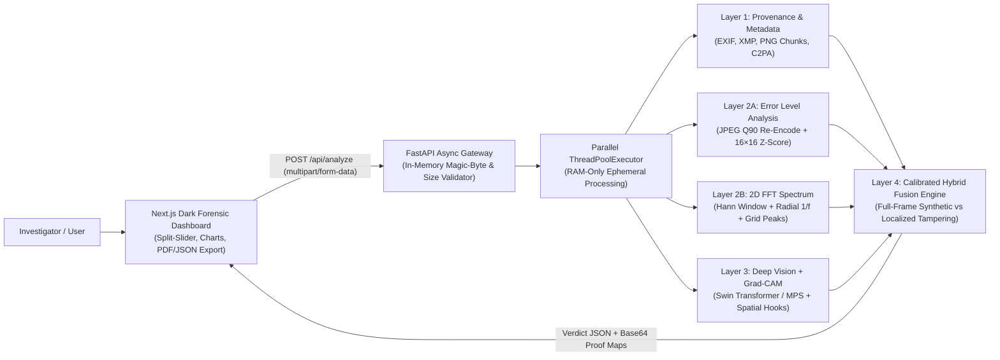
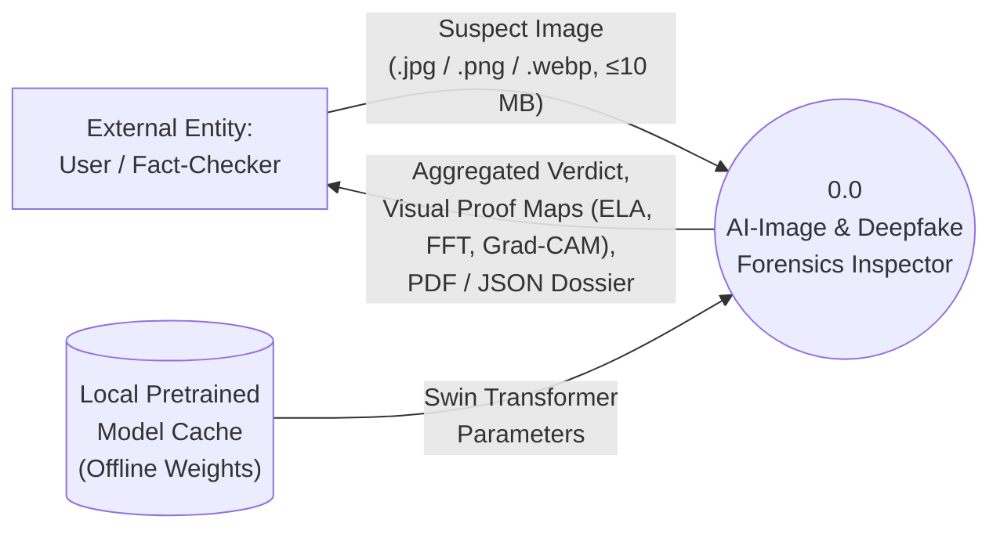
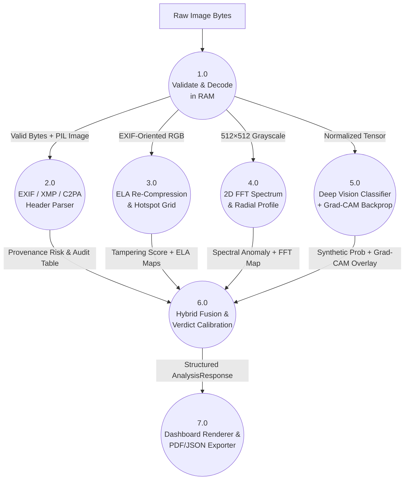

# System Architecture & Data Flow Diagrams

These diagrams and mathematical formulations are formatted for direct reuse in your project synopsis, SRS report, and viva presentation slides.

---

## 1. High-Level System Architecture

---

## 2. Data Flow Diagram — Level 0 (Context Diagram)

---

## 3. Data Flow Diagram — Level 1 (Pipeline Decomposition)

---

## 4. Layer 4 Calibrated Fusion Formulation

Instead of naive equal averaging, the inspector separates two orthogonal forensic axes:

### Axis A: Full-Frame Synthetic Probability ($S_{\text{AI}}$)
$$
S_{\text{AI}} = 0.68 \cdot P_{\text{DL}} + 0.14 \cdot A_{\text{FFT}} + 0.08 \cdot C_{\text{ELA}} + 0.10 \cdot R_{\text{meta}}
$$

- **$P_{\text{DL}}$**: Softmax probability of the synthetic class from the fine-tuned Vision Transformer (`Organika/sdxl-detector`).
- **$A_{\text{FFT}}$**: Weighted combination of off-axis periodic grid peak z-score, radial $1/f^\alpha$ deviation, and high-frequency energy ratio.
- **$C_{\text{ELA}}$**: Secondary calibration signal (since single-pass diffusion renders tend to have uniform compression error).
- **$R_{\text{meta}}$**: Provenance prior (`0.12` for C2PA, `0.18` for camera telemetry, `0.45` neutral for stripped EXIF, `0.90` for explicit AI generator prompt chunks).

### Axis B: Localized Tampering Score ($S_{\text{tamper}}$)
$$
S_{\text{tamper}} = \min\!\left(0.98,\; \sigma\!\big(0.75(\bar{z}_{\text{top6}} - 3.6)\big) + B_{\text{cluster}} + \Delta_{\text{editor}}\right)
$$

- **$\bar{z}_{\text{top6}}$**: Mean robust z-score of the top 6 edge-normalized $16 \times 16$ ELA error blocks.
- **$B_{\text{cluster}}$**: Spatial hotspot cluster boost proportional to blocks exceeding $3.2\sigma$ and $\ge 1.8$ absolute error delta.
- **$\Delta_{\text{editor}}$**: $+0.16$ reinforcement when editing software tags (e.g., *Adobe Photoshop*, *GIMP*) are present in EXIF/XMP.
